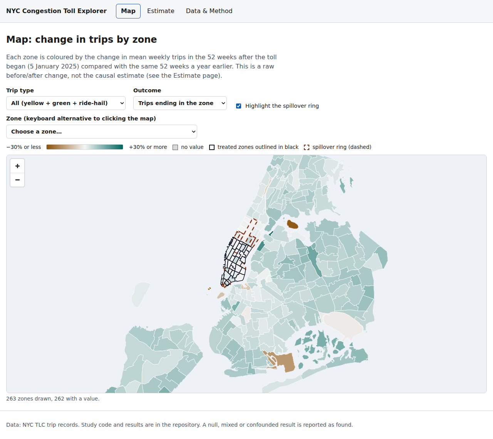
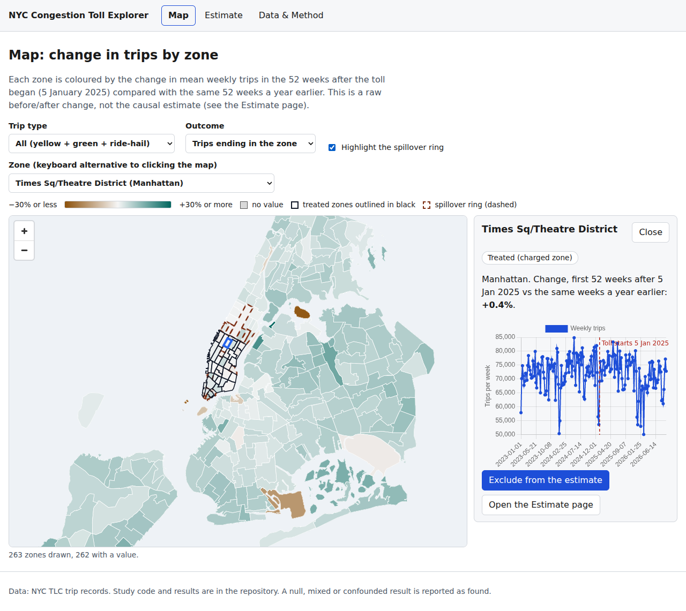
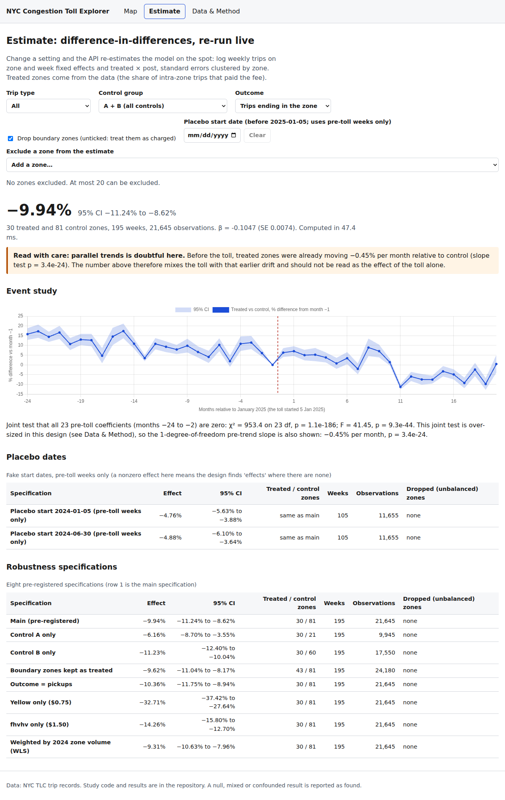
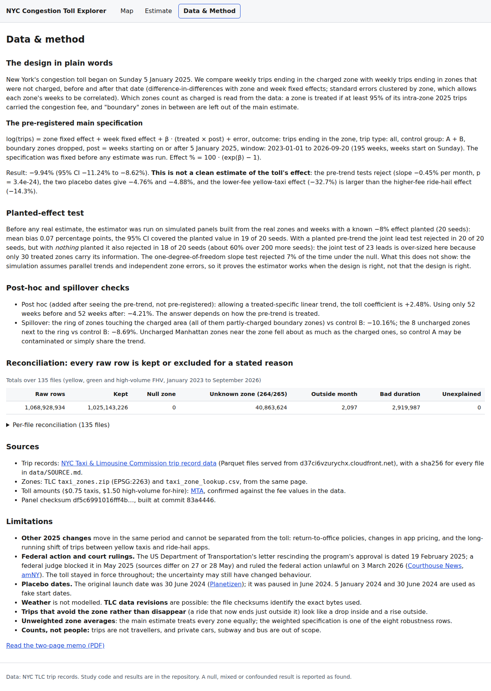
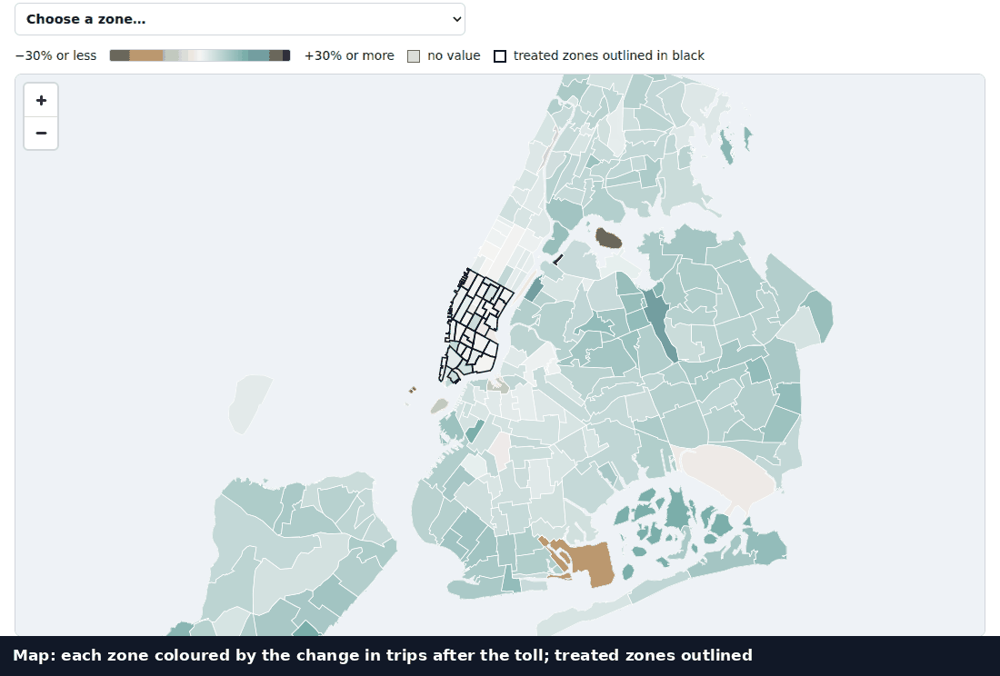

# DONE.md

Generated by `python -m congestion.done` from `docs/DONE.template.md` and `results/*.json`: every number below is filled in by code (sections 2 and 4 especially). Results generated at commit 966ffc8.

## 1. How to run everything, and which ports to tunnel

```
make setup          # uv sync, npm ci, Playwright Chromium (done on this box already)
make data           # restartable download + aggregate + reconcile (already done; data/manifest.csv says 'done' for every file)
make study          # zones, panel, planted-effect simulation, every estimate  -> results/*.json, reports/figures
make export         # api/data/* and results/estimator_reference.json
make test           # pytest + Vitest (api, web, infra) + Playwright -> results/tests.json
make bench          # local API latency -> results/api_latency.json
make results readme memo bullets   # summary.json, README table, memo.md/pdf, resume bullets
make synth          # cdk synth with cdk-nag (never deploys)
make demo           # screenshots + docs/demo.gif
```

Look at the app from your laptop (everything binds to 127.0.0.1 on the EC2 box, so tunnel):

| What | Start on the box | Port to tunnel |
|---|---|---|
| Development (hot reload) | `make dev` | **5173** (web) and **4000** (API; the dev server proxies `/graphql` to it, so 5173 alone works for the browser) |
| Production build | `npm run -w api start` and, in `web/`, `npm run build && npm run preview` | **4173** (web) plus 4000 |
| GraphQL endpoint only | `make api-dev` | **4000** (`http://127.0.0.1:4000/graphql`, health at `/health`) |

```
ssh -L 5173:127.0.0.1:5173 -L 4173:127.0.0.1:4173 -L 4000:127.0.0.1:4000 ubuntu@<this-box>
# then open http://127.0.0.1:5173
```

## 2. Test results and every `results/*.json` value

Test totals (from the runners' JSON output, `results/tests.json`): pytest **31** passed; Vitest **71** of 71 passed (api, web and infra); Playwright **22** passed (includes axe on every page at desktop and 390 px width).

Equivalence of the TypeScript estimator and statsmodels: **61 cases**, max relative difference **9.59e-13** (tolerance 1e-8). API latency, local and not Lambda: cold-cache estimate p50 5.2 ms, p95 10.4 ms, max 105.5 ms; warm p95 3.5 ms; panel load 1.41 ms.

Every scalar in `results/*.json` (flattened by code; the long per-case, per-file and per-zone tables stay in their own files):

### results/api_latency.json

| key | value |
|---|---|
| `label` | local, not Lambda |
| `what` | HTTP round trip to a freshly started local server on 127.0.0.1 (includes JSON, GraphQL execution and the estimate) |
| `cases` | 36 |
| `rounds` | 5 |
| `cold_client_ms.n` | 180 |
| `cold_client_ms.p50` | 5.2493909999993775 |
| `cold_client_ms.p95` | 10.363134000000173 |
| `cold_client_ms.max` | 105.51846599999999 |
| `cold_client_ms.mean` | 7.43536397222225 |
| `warm_client_ms.n` | 180 |
| `warm_client_ms.p50` | 1.8669900000004418 |
| `warm_client_ms.p95` | 3.4540810000000874 |
| `warm_client_ms.max` | 9.461991000000125 |
| `warm_client_ms.mean` | 2.1332638000000315 |
| `cold_compute_ms.n` | 180 |
| `cold_compute_ms.p50` | 2.7597670000000107 |
| `cold_compute_ms.p95` | 5.293908999999985 |
| `cold_compute_ms.max` | 25.883438999999953 |
| `cold_compute_ms.mean` | 3.3461585777777754 |
| `warm_compute_ms.n` | 180 |
| `warm_compute_ms.p50` | 0.00877200000013545 |
| `warm_compute_ms.p95` | 0.015757000000007793 |
| `warm_compute_ms.max` | 0.05167699999992692 |
| `warm_compute_ms.mean` | 0.00996175000000916 |
| `panel_load_ms.n` | 5 |
| `panel_load_ms.p50` | 1.4122810000000072 |
| `panel_load_ms.p95` | 1.509141999999997 |
| `panel_load_ms.max` | 1.509141999999997 |
| `panel_load_ms.mean` | 1.424981600000001 |
| `target_cold_p95_ms` | 1000 |
| `meets_target` | True |
| `machine.cpu` | Intel(R) Xeon(R) Platinum 8259CL CPU @ 2.50GHz |
| `machine.vcpus` | 4 |
| `machine.total_mem_gb` | 15 |
| `machine.node` | v24.22.1 |
| `machine.platform` | linux 7.0.0-1017-aws |
| `commit` | 83a4446 |
| `dirty` | True |
| `generated_at_utc` | 2026-11-16T20:54:49+00:00 |
| `command` | npm run -w api bench |

### results/estimator_equivalence.json

| key | value |
|---|---|
| `n_cases` | 61 |
| `tolerance_rel` | 1e-08 |
| `max_rel_diff_beta` | 9.590813568705403e-13 |
| `max_rel_diff_se` | 3.198572519726253e-13 |
| `max_rel_diff_effect_pct` | 9.097913955621204e-13 |
| `max_rel_diff` | 9.590813568705403e-13 |
| `worst_case_for_beta` | {"tripType":"ALL","control":"AB","dropBoundary":true,"outcome":"DROPOFFS","excludeZones":[7,33,51,61,129,142,162,213,224,233],"placeboStart":null} |
| `reference` | results/estimator_reference.json (statsmodels) |
| `commit` | 3df4cd0 |
| `dirty` | False |
| `generated_at_utc` | 2026-11-16T21:22:36+00:00 |
| `command` | npm run -w api test |

### results/event_study.json

| key | value |
|---|---|
| `yellow_A.nTreated` | 30 |
| `yellow_A.nControl` | 21 |
| `yellow_A.nObs` | 9945 |
| `yellow_A.lead_chi2` | 727.4615217796098 |
| `yellow_A.lead_df` | 23 |
| `yellow_A.lead_p_chi2` | 7.229150183162112e-139 |
| `yellow_A.lead_F` | 31.628761816504774 |
| `yellow_A.lead_p_F` | 2.7608245523427665e-22 |
| `yellow_A.slope.slope_per_month` | -0.0001929887009376116 |
| `yellow_A.slope.se` | 0.0018179607292796627 |
| `yellow_A.slope.p` | 0.9154580298691221 |
| `yellow_A.slope.n_obs` | 5355 |
| `yellow_B.nTreated` | 30 |
| `yellow_B.nControl` | 60 |
| `yellow_B.nObs` | 17550 |
| `yellow_B.lead_chi2` | 856.6298064048548 |
| `yellow_B.lead_df` | 23 |
| `yellow_B.lead_p_chi2` | 3.5804847912891486e-166 |
| `yellow_B.lead_F` | 37.244774191515425 |
| `yellow_B.lead_p_F` | 4.6364485465164444e-36 |
| `yellow_B.slope.slope_per_month` | -0.0035945909377699627 |
| `yellow_B.slope.se` | 0.0015770884644858813 |
| `yellow_B.slope.p` | 0.022651754279320233 |
| `yellow_B.slope.n_obs` | 9450 |
| `yellow_AB.nTreated` | 30 |
| `yellow_AB.nControl` | 81 |
| `yellow_AB.nObs` | 21645 |
| `yellow_AB.lead_chi2` | 495.0158811308013 |
| `yellow_AB.lead_df` | 23 |
| `yellow_AB.lead_p_chi2` | 3.842138237327409e-90 |
| `yellow_AB.lead_F` | 21.522429614382666 |
| `yellow_AB.lead_p_F` | 1.0686624149954782e-30 |
| `yellow_AB.slope.slope_per_month` | -0.0027126940615523802 |
| `yellow_AB.slope.se` | 0.0013112358306388613 |
| `yellow_AB.slope.p` | 0.03856418722872445 |
| `yellow_AB.slope.n_obs` | 11655 |
| `fhvhv_A.nTreated` | 30 |
| `fhvhv_A.nControl` | 21 |
| `fhvhv_A.nObs` | 9945 |
| `fhvhv_A.lead_chi2` | 810.3483765538939 |
| `fhvhv_A.lead_df` | 23 |
| `fhvhv_A.lead_p_chi2` | 2.2447730083125789e-156 |
| `fhvhv_A.lead_F` | 35.23253811103886 |
| `fhvhv_A.lead_p_F` | 2.344183086323933e-23 |
| `fhvhv_A.slope.slope_per_month` | -0.0050823526515962805 |
| `fhvhv_A.slope.se` | 0.0011977627619839646 |
| `fhvhv_A.slope.p` | 2.203502108593976e-05 |
| `fhvhv_A.slope.n_obs` | 5355 |
| `fhvhv_B.nTreated` | 30 |
| `fhvhv_B.nControl` | 60 |
| `fhvhv_B.nObs` | 17550 |
| `fhvhv_B.lead_chi2` | 1718.4590214299528 |
| `fhvhv_B.lead_df` | 23 |
| `fhvhv_B.lead_p_chi2` | 0.0 |
| `fhvhv_B.lead_F` | 74.71560962738926 |
| `fhvhv_B.lead_p_F` | 2.298378228683045e-48 |
| `fhvhv_B.slope.slope_per_month` | -0.007694251015444724 |
| `fhvhv_B.slope.se` | 0.0004088457065032387 |
| `fhvhv_B.slope.p` | 5.232565428852058e-79 |
| `fhvhv_B.slope.n_obs` | 9450 |
| `fhvhv_AB.nTreated` | 30 |
| `fhvhv_AB.nControl` | 81 |
| `fhvhv_AB.nObs` | 21645 |
| `fhvhv_AB.lead_chi2` | 1341.2716963148052 |
| `fhvhv_AB.lead_df` | 23 |
| `fhvhv_AB.lead_p_chi2` | 2.269759877351656e-269 |
| `fhvhv_AB.lead_F` | 58.31616070933936 |
| `fhvhv_AB.lead_p_F` | 4.7181704068880047e-51 |
| `fhvhv_AB.slope.slope_per_month` | -0.007017092180370791 |
| `fhvhv_AB.slope.se` | 0.0004929398761594929 |
| `fhvhv_AB.slope.p` | 5.541311196544289e-46 |
| `fhvhv_AB.slope.n_obs` | 11655 |
| `all_A.nTreated` | 30 |
| `all_A.nControl` | 21 |
| `all_A.nObs` | 9945 |
| `all_A.lead_chi2` | 766.6559672313874 |
| `all_A.lead_df` | 23 |
| `all_A.lead_p_chi2` | 3.861588180573124e-147 |
| `all_A.lead_F` | 33.33286814049511 |
| `all_A.lead_p_F` | 8.344912739970446e-23 |
| `all_A.slope.slope_per_month` | -0.0032691392181730147 |
| `all_A.slope.se` | 0.0010639750685275237 |
| `all_A.slope.p` | 0.0021222315523811972 |
| `all_A.slope.n_obs` | 5355 |
| `all_B.nTreated` | 30 |
| `all_B.nControl` | 60 |
| `all_B.nObs` | 17550 |
| `all_B.lead_chi2` | 983.9324226805227 |
| `all_B.lead_df` | 23 |
| `all_B.lead_p_chi2` | 3.474829486664275e-193 |
| `all_B.lead_F` | 42.77967055132707 |
| `all_B.lead_p_F` | 1.9046041612167757e-38 |
| `all_B.slope.slope_per_month` | -0.004969364704529137 |
| `all_B.slope.se` | 0.0003883415988930388 |
| `all_B.slope.p` | 1.7178489946051304e-37 |
| `all_B.slope.n_obs` | 9450 |
| `all_AB.nTreated` | 30 |
| `all_AB.nControl` | 81 |
| `all_AB.nObs` | 21645 |
| `all_AB.lead_chi2` | 953.3601822873902 |
| `all_AB.lead_df` | 23 |
| `all_AB.lead_p_chi2` | 1.0863678916997278e-186 |
| `all_AB.lead_F` | 41.4504427081474 |
| `all_AB.lead_p_F` | 9.263577668930483e-44 |
| `all_AB.slope.slope_per_month` | -0.004528565504360548 |
| `all_AB.slope.se` | 0.0004462257852353568 |
| `all_AB.slope.p` | 3.361624633874192e-24 |
| `all_AB.slope.n_obs` | 11655 |

### results/exploratory.json

| key | value |
|---|---|
| `note` | Post hoc: added after the pre-registered estimates showed a pre-trend. Not a replacement for the main specification. |
| `trend_adjusted.label` | Main DiD + treated-specific linear trend (post hoc) |
| `trend_adjusted.beta` | 0.024489301439452223 |
| `trend_adjusted.se` | 0.005731256693705861 |
| `trend_adjusted.effect_pct` | 2.479162725327688 |
| `trend_adjusted.ci_low_pct` | 1.3344498284902917 |
| `trend_adjusted.ci_high_pct` | 3.636806739059728 |
| `trend_adjusted.trend_per_month_pct` | -0.574525894807365 |
| `trend_adjusted.trend_se` | 0.0004358642038024754 |
| `trend_adjusted.n_obs` | 21645 |
| `trend_adjusted.n_weeks` | 195 |
| `trend_adjusted.n_treated` | 30 |
| `trend_adjusted.n_control` | 81 |
| `short_window_52_52.label` | Main DiD, 52 weeks before vs 52 weeks after (post hoc) |
| `short_window_52_52.beta` | -0.043018604953682676 |
| `short_window_52_52.se` | 0.0045518571439763485 |
| `short_window_52_52.effect_pct` | -4.21064316642269 |
| `short_window_52_52.ci_low_pct` | -5.061424863422658 |
| `short_window_52_52.ci_high_pct` | -3.3522372819424606 |
| `short_window_52_52.n_treated` | 30 |
| `short_window_52_52.n_control` | 81 |
| `short_window_52_52.n_weeks` | 104 |
| `short_window_52_52.n_obs` | 11544 |
| `short_window_52_52.dropped_zones` | [] |
| `commit` | 966ffc8 |
| `dirty` | True |
| `generated_at_utc` | 2026-11-16T20:45:00+00:00 |
| `command` | python -m congestion.exploratory |

### results/headline.json

| key | value |
|---|---|
| `total_trips_raw` | 1068928934 |
| `total_trips_kept` | 1025143226 |
| `n_files` | 135 |
| `first_month` | 2023-01 |
| `last_month` | 2026-09 |
| `n_treated_zones` | 30 |
| `n_boundary_zones` | 13 |
| `n_control_a` | 21 |
| `n_control_b` | 60 |
| `n_ring` | 14 |
| `main_beta` | -0.1047081208814119 |
| `main_se` | 0.00743863464971891 |
| `main_estimate_pct` | -9.941265313104452 |
| `ci_low_pct` | -11.244747553589319 |
| `ci_high_pct` | -8.618639800481587 |
| `pretrend_stat` | 953.3601822873902 |
| `pretrend_df` | 23 |
| `pretrend_p` | 1.0863678916997278e-186 |
| `pretrend_F` | 41.4504427081474 |
| `pretrend_p_F` | 9.263577668930483e-44 |
| `pretrend_slope_per_month_pct` | -0.45183270126544217 |
| `pretrend_slope_p` | 3.361624633874192e-24 |
| `n_specs` | 8 |
| `spec_min_pct` | -32.70647921156006 |
| `spec_max_pct` | -6.161835955048467 |
| `yellow_pct` | -32.70647921156006 |
| `fhvhv_pct` | -14.263117370632683 |
| `placebo_2024_01_05_pct` | -4.7552119516309554 |
| `placebo_2024_06_30_pct` | -4.880314105165729 |
| `spillover_pct` | -10.162007932559103 |
| `outer_ring_pct` | -8.686774249012952 |
| `first_week` | 2023-01-01 |
| `last_week` | 2026-09-20 |
| `commit` | 966ffc8 |
| `dirty` | True |
| `generated_at_utc` | 2026-11-16T20:44:22+00:00 |
| `command` | python -m congestion.run_study |

### results/placebos.json

| key | value |
|---|---|
| `placebos[0].id` | placebo_2024-01-05 |
| `placebos[0].label` | Placebo start 2024-01-05 |
| `placebos[0].case.trip_type` | all |
| `placebos[0].case.control` | AB |
| `placebos[0].case.drop_boundary` | True |
| `placebos[0].case.outcome` | dropoffs |
| `placebos[0].case.exclude` | [] |
| `placebos[0].case.placebo_start` | 2024-01-05 |
| `placebos[0].case.weighted` | False |
| `placebos[0].beta` | -0.04871989213069457 |
| `placebos[0].se` | 0.004688823756490328 |
| `placebos[0].effect_pct` | -4.7552119516309554 |
| `placebos[0].ci_low_pct` | -5.626494831948648 |
| `placebos[0].ci_high_pct` | -3.8758851414392614 |
| `placebos[0].n_treated` | 30 |
| `placebos[0].n_control` | 81 |
| `placebos[0].n_weeks` | 105 |
| `placebos[0].n_obs` | 11655 |
| `placebos[0].dropped_zones` | [] |
| `placebos[1].id` | placebo_2024-06-30 |
| `placebos[1].label` | Placebo start 2024-06-30 |
| `placebos[1].case.trip_type` | all |
| `placebos[1].case.control` | AB |
| `placebos[1].case.drop_boundary` | True |
| `placebos[1].case.outcome` | dropoffs |
| `placebos[1].case.exclude` | [] |
| `placebos[1].case.placebo_start` | 2024-06-30 |
| `placebos[1].case.weighted` | False |
| `placebos[1].beta` | -0.05003423580998405 |
| `placebos[1].se` | 0.006599243960124415 |
| `placebos[1].effect_pct` | -4.880314105165729 |
| `placebos[1].ci_low_pct` | -6.10269644280711 |
| `placebos[1].ci_high_pct` | -3.6420184396355637 |
| `placebos[1].n_treated` | 30 |
| `placebos[1].n_control` | 81 |
| `placebos[1].n_weeks` | 105 |
| `placebos[1].n_obs` | 11655 |
| `placebos[1].dropped_zones` | [] |
| `commit` | 966ffc8 |
| `dirty` | True |
| `generated_at_utc` | 2026-11-16T20:44:11+00:00 |
| `command` | python -m congestion.placebo |

### results/planted.json

| key | value |
|---|---|
| `planted_effect_pct` | -8.0 |
| `seeds` | list of 20 items |
| `n_seeds` | 20 |
| `bias_pp` | 0.06578019416029246 |
| `mean_estimate_pct` | -7.9342198058397075 |
| `sd_estimate_pct` | 0.45358365919995286 |
| `mean_se_beta` | 0.004721865964931693 |
| `coverage` | 19 |
| `coverage_of` | 20 |
| `pass_bias` | True |
| `pass_coverage` | True |
| `trend_per_month_pct` | 0.5 |
| `trend_reject_F` | 20 |
| `trend_reject_chi2` | 20 |
| `null_reject_F` | 18 |
| `null_reject_chi2` | 18 |
| `slope_trend_reject` | 20 |
| `slope_null_reject` | 2 |
| `size_200_seeds.seeds` | 100-299 |
| `size_200_seeds.n` | 200 |
| `size_200_seeds.joint_chi2` | 0.64 |
| `size_200_seeds.joint_F` | 0.595 |
| `size_200_seeds.slope` | 0.07 |
| `decision_statistic` | F form: chi2/q vs F(q, G-1) |
| `pass_trend_power` | True |
| `per_seed_estimate_pct` | list of 20 items |
| `per_seed_ci_low_pct` | list of 20 items |
| `per_seed_ci_high_pct` | list of 20 items |
| `reference_check_seed0.demeaned_beta` | -0.08170627253131288 |
| `reference_check_seed0.statsmodels_beta` | -0.08170627253130196 |
| `parameters.n_zones` | 111 |
| `parameters.n_treated` | 30 |
| `parameters.n_control` | 81 |
| `parameters.n_weeks` | 195 |
| `parameters.rho` | 0.5051562595971011 |
| `parameters.median_zone_sd` | 0.050987100669204574 |
| `parameters.min_zone_sd` | 0.021524807785422966 |
| `parameters.max_zone_sd` | 0.4130649688442695 |
| `parameters.dropped_by_balancing` | [] |
| `runtime_s` | 34.7 |
| `commit` | 5e908ea |
| `dirty` | True |
| `generated_at_utc` | 2026-11-16T20:42:29+00:00 |
| `command` | python -m congestion.planted |

### results/reconciliation.json

| key | value |
|---|---|
| `totals.n_files_done` | 135 |
| `totals.n_files_not_done` | 0 |
| `totals.total_trips_raw` | 1068928934 |
| `totals.total_trips_kept` | 1025143226 |
| `totals.dropped_by_reason.null_zone` | 0 |
| `totals.dropped_by_reason.unknown_zone` | 40863624 |
| `totals.dropped_by_reason.outside_month` | 2097 |
| `totals.dropped_by_reason.bad_duration` | 2919987 |
| `totals.unexplained` | 0 |
| `commit` | 752e775 |
| `dirty` | True |
| `generated_at_utc` | 2026-11-16T20:23:00+00:00 |
| `command` | python -m congestion.download |

### results/specs.json

| key | value |
|---|---|
| `specs[0].id` | main |
| `specs[0].label` | Main (pre-registered) |
| `specs[0].case.trip_type` | all |
| `specs[0].case.control` | AB |
| `specs[0].case.drop_boundary` | True |
| `specs[0].case.outcome` | dropoffs |
| `specs[0].case.exclude` | [] |
| `specs[0].case.placebo_start` | None |
| `specs[0].case.weighted` | False |
| `specs[0].beta` | -0.1047081208814119 |
| `specs[0].se` | 0.00743863464971891 |
| `specs[0].effect_pct` | -9.941265313104452 |
| `specs[0].ci_low_pct` | -11.244747553589319 |
| `specs[0].ci_high_pct` | -8.618639800481587 |
| `specs[0].n_treated` | 30 |
| `specs[0].n_control` | 81 |
| `specs[0].n_weeks` | 195 |
| `specs[0].n_obs` | 21645 |
| `specs[0].dropped_zones` | [] |
| `specs[1].id` | control_a |
| `specs[1].label` | Control A only |
| `specs[1].case.trip_type` | all |
| `specs[1].case.control` | A |
| `specs[1].case.drop_boundary` | True |
| `specs[1].case.outcome` | dropoffs |
| `specs[1].case.exclude` | [] |
| `specs[1].case.placebo_start` | None |
| `specs[1].case.weighted` | False |
| `specs[1].beta` | -0.06359854657263152 |
| `specs[1].se` | 0.014002737941308727 |
| `specs[1].effect_pct` | -6.161835955048467 |
| `specs[1].ci_low_pct` | -8.702192108173623 |
| `specs[1].ci_high_pct` | -3.5507945408668085 |
| `specs[1].n_treated` | 30 |
| `specs[1].n_control` | 21 |
| `specs[1].n_weeks` | 195 |
| `specs[1].n_obs` | 9945 |
| `specs[1].dropped_zones` | [] |
| `specs[2].id` | control_b |
| `specs[2].label` | Control B only |
| `specs[2].case.trip_type` | all |
| `specs[2].case.control` | B |
| `specs[2].case.drop_boundary` | True |
| `specs[2].case.outcome` | dropoffs |
| `specs[2].case.exclude` | [] |
| `specs[2].case.placebo_start` | None |
| `specs[2].case.weighted` | False |
| `specs[2].beta` | -0.1190964718894879 |
| `specs[2].se` | 0.006803409404974638 |
| `specs[2].effect_pct` | -11.227784360288828 |
| `specs[2].ci_low_pct` | -12.403654705222689 |
| `specs[2].ci_high_pct` | -10.036129440514063 |
| `specs[2].n_treated` | 30 |
| `specs[2].n_control` | 60 |
| `specs[2].n_weeks` | 195 |
| `specs[2].n_obs` | 17550 |
| `specs[2].dropped_zones` | [] |
| `specs[3].id` | boundary_treated |
| `specs[3].label` | Boundary zones kept as treated |
| `specs[3].case.trip_type` | all |
| `specs[3].case.control` | AB |
| `specs[3].case.drop_boundary` | False |
| `specs[3].case.outcome` | dropoffs |
| `specs[3].case.exclude` | [] |
| `specs[3].case.placebo_start` | None |
| `specs[3].case.weighted` | False |
| `specs[3].beta` | -0.10110009302506029 |
| `specs[3].se` | 0.008082543562174192 |
| `specs[3].effect_pct` | -9.615743997792258 |
| `specs[3].ci_low_pct` | -11.036284225514503 |
| `specs[3].ci_high_pct` | -8.172521100837848 |
| `specs[3].n_treated` | 43 |
| `specs[3].n_control` | 81 |
| `specs[3].n_weeks` | 195 |
| `specs[3].n_obs` | 24180 |
| `specs[3].dropped_zones` | [] |
| `specs[4].id` | pickups |
| `specs[4].label` | Outcome = pickups |
| `specs[4].case.trip_type` | all |
| `specs[4].case.control` | AB |
| `specs[4].case.drop_boundary` | True |
| `specs[4].case.outcome` | pickups |
| `specs[4].case.exclude` | [] |
| `specs[4].case.placebo_start` | None |
| `specs[4].case.weighted` | False |
| `specs[4].beta` | -0.10933598457404232 |
| `specs[4].se` | 0.008015979235708024 |
| `specs[4].effect_pct` | -10.357081948079571 |
| `specs[4].ci_low_pct` | -11.754458718801786 |
| `specs[4].ci_high_pct` | -8.937577579622612 |
| `specs[4].n_treated` | 30 |
| `specs[4].n_control` | 81 |
| `specs[4].n_weeks` | 195 |
| `specs[4].n_obs` | 21645 |
| `specs[4].dropped_zones` | [] |
| `specs[5].id` | yellow |
| `specs[5].label` | Yellow only ($0.75) |
| `specs[5].case.trip_type` | yellow |
| `specs[5].case.control` | AB |
| `specs[5].case.drop_boundary` | True |
| `specs[5].case.outcome` | dropoffs |
| `specs[5].case.exclude` | [] |
| `specs[5].case.placebo_start` | None |
| `specs[5].case.weighted` | False |
| `specs[5].beta` | -0.39610622754645086 |
| `specs[5].se` | 0.037032900968402435 |
| `specs[5].effect_pct` | -32.70647921156006 |
| `specs[5].ci_low_pct` | -37.417805402337976 |
| `specs[5].ci_high_pct` | -27.64047395242074 |
| `specs[5].n_treated` | 30 |
| `specs[5].n_control` | 81 |
| `specs[5].n_weeks` | 195 |
| `specs[5].n_obs` | 21645 |
| `specs[5].dropped_zones` | [] |
| `specs[6].id` | fhvhv |
| `specs[6].label` | fhvhv only ($1.50) |
| `specs[6].case.trip_type` | fhvhv |
| `specs[6].case.control` | AB |
| `specs[6].case.drop_boundary` | True |
| `specs[6].case.outcome` | dropoffs |
| `specs[6].case.exclude` | [] |
| `specs[6].case.placebo_start` | None |
| `specs[6].case.weighted` | False |
| `specs[6].beta` | -0.1538870838957666 |
| `specs[6].se` | 0.009221720117801145 |
| `specs[6].effect_pct` | -14.263117370632683 |
| `specs[6].ci_low_pct` | -15.79882611434742 |
| `specs[6].ci_high_pct` | -12.699399500243247 |
| `specs[6].n_treated` | 30 |
| `specs[6].n_control` | 81 |
| `specs[6].n_weeks` | 195 |
| `specs[6].n_obs` | 21645 |
| `specs[6].dropped_zones` | [] |
| `specs[7].id` | weighted |
| `specs[7].label` | Weighted by 2024 zone volume (WLS) |
| `specs[7].case.trip_type` | all |
| `specs[7].case.control` | AB |
| `specs[7].case.drop_boundary` | True |
| `specs[7].case.outcome` | dropoffs |
| `specs[7].case.exclude` | [] |
| `specs[7].case.placebo_start` | None |
| `specs[7].case.weighted` | True |
| `specs[7].beta` | -0.09768472937374759 |
| `specs[7].se` | 0.007507958097331057 |
| `specs[7].effect_pct` | -9.306521141522461 |
| `specs[7].ci_low_pct` | -10.631333948753385 |
| `specs[7].ci_high_pct` | -7.962069135769823 |
| `specs[7].n_treated` | 30 |
| `specs[7].n_control` | 81 |
| `specs[7].n_weeks` | 195 |
| `specs[7].n_obs` | 21645 |
| `specs[7].dropped_zones` | [] |
| `commit` | 966ffc8 |
| `dirty` | True |
| `generated_at_utc` | 2026-11-16T20:44:10+00:00 |
| `command` | python -m congestion.specs |

### results/spillover.json

| key | value |
|---|---|
| `ring_vs_control_b.id` | ring_vs_control_b |
| `ring_vs_control_b.n_zones_tested` | 13 |
| `ring_vs_control_b.zone_ids` | list of 13 items |
| `ring_vs_control_b.beta` | -0.10716222590294122 |
| `ring_vs_control_b.se` | 0.01636184550773825 |
| `ring_vs_control_b.effect_pct` | -10.162007932559103 |
| `ring_vs_control_b.ci_low_pct` | -12.99728438183141 |
| `ring_vs_control_b.ci_high_pct` | -7.2343344530713445 |
| `ring_vs_control_b.n_treated` | 13 |
| `ring_vs_control_b.n_control` | 60 |
| `ring_vs_control_b.n_weeks` | 195 |
| `ring_vs_control_b.n_obs` | 14235 |
| `ring_vs_control_b.dropped_zones` | [] |
| `outer_ring_vs_control_b.id` | outer_ring_vs_control_b |
| `outer_ring_vs_control_b.n_zones_tested` | 8 |
| `outer_ring_vs_control_b.zone_ids` | [24, 41, 151, 236, 238, 239, 262, 263] |
| `outer_ring_vs_control_b.beta` | -0.09087454851711364 |
| `outer_ring_vs_control_b.se` | 0.008715035144355657 |
| `outer_ring_vs_control_b.effect_pct` | -8.686774249012952 |
| `outer_ring_vs_control_b.ci_low_pct` | -10.233264094966376 |
| `outer_ring_vs_control_b.ci_high_pct` | -7.113641673773186 |
| `outer_ring_vs_control_b.n_treated` | 8 |
| `outer_ring_vs_control_b.n_control` | 60 |
| `outer_ring_vs_control_b.n_weeks` | 195 |
| `outer_ring_vs_control_b.n_obs` | 13260 |
| `outer_ring_vs_control_b.dropped_zones` | [] |
| `main_without_outer_ring.id` | main_without_ring2 |
| `main_without_outer_ring.beta` | -0.11309016992341282 |
| `main_without_outer_ring.se` | 0.007193980566206608 |
| `main_without_outer_ring.effect_pct` | -10.69298715797803 |
| `main_without_outer_ring.ci_low_pct` | -11.943375017826419 |
| `main_without_outer_ring.ci_high_pct` | -9.424844020768363 |
| `main_without_outer_ring.n_treated` | 30 |
| `main_without_outer_ring.n_control` | 73 |
| `main_without_outer_ring.n_weeks` | 195 |
| `main_without_outer_ring.n_obs` | 20085 |
| `main_without_outer_ring.dropped_zones` | [] |
| `note` | Ring zones are all boundary zones (partly charged): the ring estimate mixes partial treatment with spillover. The outer ring (control-A zones touching the ring) is the clean test of contamination of control A. |
| `commit` | 966ffc8 |
| `dirty` | True |
| `generated_at_utc` | 2026-11-16T20:44:13+00:00 |
| `command` | python -m congestion.spillover |

### results/tests.json

| key | value |
|---|---|
| `pytest.total` | 31 |
| `pytest.passed` | 31 |
| `pytest.failed` | 0 |
| `pytest.exit` | 0 |
| `vitest_api.total` | 37 |
| `vitest_api.passed` | 37 |
| `vitest_api.failed` | 0 |
| `vitest_api.exit` | 0 |
| `vitest_web.total` | 21 |
| `vitest_web.passed` | 21 |
| `vitest_web.failed` | 0 |
| `vitest_web.exit` | 0 |
| `vitest_infra.total` | 13 |
| `vitest_infra.passed` | 13 |
| `vitest_infra.failed` | 0 |
| `vitest_infra.exit` | 0 |
| `playwright.total` | 23 |
| `playwright.passed` | 22 |
| `playwright.failed` | 0 |
| `playwright.skipped` | 1 |
| `playwright.exit` | 0 |
| `vitest_total` | 71 |
| `vitest_passed` | 71 |
| `commit` | 3df4cd0 |
| `dirty` | False |
| `generated_at_utc` | 2026-11-16T21:23:33+00:00 |
| `command` | python -m congestion.test_report |

### results/zones.json

| key | value |
|---|---|
| `counts.OTHER` | 126 |
| `counts.CONTROL_B` | 60 |
| `counts.TREATED` | 30 |
| `counts.CONTROL_A` | 21 |
| `counts.UNCLASSIFIED` | 15 |
| `counts.BOUNDARY` | 13 |
| `n_ring` | 14 |
| `n_ring2` | 8 |
| `ring_touches_equals_near_1ft` | True |
| `fee_jump.first_day_treated_share_over_20pct` | 2025-01-05 |
| `fee_jump.share_treated_2025_01_04` | 2.0527768939432816e-05 |
| `fee_jump.share_treated_2025_01_05` | 0.9510654454307813 |
| `fee_jump.max_share_treated_before_toll` | 2.0527768939432816e-05 |
| `commit` | 83a4446 |
| `dirty` | True |
| `generated_at_utc` | 2026-11-16T20:50:21+00:00 |
| `command` | python -m congestion.zones |


## 3. Screenshots and the demo GIF

Screenshots (real, from Playwright against the running app) are in `docs/screenshots/`: `map-desktop.png`, `map-zone-panel-desktop.png`, `estimate-desktop.png`, `method-desktop.png` and the `-phone` versions at 390 px width. The captioned demo is `docs/demo.gif`.







## 4. The study's findings in plain English

**The honest summary.** The pre-registered main estimate is −9.94% (95% CI −11.24% to −8.62%), but the study's own checks say that number is not a clean measure of what the toll did. The data do not support a confident causal claim.

- **The main estimate.** Comparing weekly trips ending in the 30 charged zones with weekly trips ending in 21 uncharged Manhattan zones and the 60 busiest non-Manhattan zones, before and after 5 January 2025, with zone and week fixed effects and standard errors clustered by zone, gives −9.94%. *What it means:* if the charged and uncharged zones would otherwise have moved in parallel, trips into the charged zone fell by about that much. *What it cannot show:* that they would have moved in parallel. They did not.
- **The pre-trend test.** The event study shows charged zones sliding down relative to uncharged ones for two years before the toll: −0.45% per month (p = 3.4e-24). The pre-registered joint test of all 23 leads rejects too (chi-squared 953.4 on 23 df, p = 1.1e-186), but the simulation showed that this joint test rejects 18 of 20 times even when nothing is going on (about 60% over 200 more runs), because only the treated clusters carry its information. So the slope test (rejects 2 of 20 under the null) is the better evidence, and it agrees. *What it means:* parallel trends, the assumption DiD stands on, fails. *What it cannot show:* why (a post-pandemic recovery that was fading, a shift of riders between apps and taxis, something else).
- **Placebos.** Pretending the toll started 5 January 2024 gives −4.76% (CI −5.63% to −3.88%); pretending 30 June 2024 (the launch date that was paused) gives −4.88%. A design that finds nonzero "effects" where there was none is picking up the trend. *Cannot show:* how much of the real estimate is trend (the two post hoc numbers below try).
- **The robustness range.** Eight specifications (pre-registered) run from −32.71% to −6.16%: control A only −6.2%, control B only −11.2%, boundary zones treated −9.6%, pickups −10.4%, weighted −9.3%, yellow −32.7%, ride-hail −14.3%. *The dose check:* the toll is $0.75 for taxis and $1.50 for ride-hail, so a toll-driven effect should be larger for ride-hail; it is the other way round (yellow −32.7%, ride-hail −14.3%). Failing this check is evidence against the simple toll story (yellow's relative decline predates the toll).
- **Spillover.** The ring of zones touching the charged area turned out to consist entirely of partly-charged boundary zones, so the pre-planned ring test mixes partial treatment with spillover (−10.2%). The cleaner added test (the 8 uncharged zones next to the ring against control B) gives −8.7%: control A zones next to the charged area fell about as much as the charged ones. Either control A is contaminated by spillover or it simply shares the trend; this design cannot separate the two.
- **The planted-effect result (the gate before real data).** On simulated panels built from the real zones and weeks with a known −8% effect, the estimator recovered −7.93% on average: bias 0.07 percentage points (pass: below 1) and the 95% CI covered the truth in 19 of 20 seeds (pass: at least 17). With a planted 0.5%-per-month pre-trend the joint lead test rejected in 20 of 20 seeds (pass: at least 18), though its size problem makes that power figure nearly vacuous. *What it proves:* the estimator is unbiased and its intervals are honest when parallel trends holds and zone errors are independent. *What it cannot show:* that the real design satisfies those assumptions.
- **Post hoc (not pre-registered, added after seeing the pre-trend).** Allowing a treated-specific linear trend: 2.48% (CI 1.33% to 3.64%). Using only 52 weeks before and 52 weeks after: −4.21% (CI −5.06% to −3.35%). The answer ranges from a decline to a small rise depending on how the pre-existing divergence is handled, which is itself the finding.
- **Zone classification.** 30 zones are treated (at least 95% of their intra-zone trips in February to December 2025 paid the fee); the fee share in those zones goes from 0.00% on 4 January to 95.1% on 5 January 2025.

**A note on the resume bullet.** The spec's bullet says "event-study pre-trend test p = 1.1e-186". That p-value is a rejection of parallel trends: say so (for example "pre-trend test rejected parallel trends; reported as a limitation"). Do not present it as supporting the design.

## 5. What's left for you

Phase 9 (deploy) needs your AWS account; the exact steps are in `BLOCKERS.md`, in order:
### 1. Choose where the commands run
### 2. Check who you are and the region
### 3. Bootstrap CDK once per account and region
### 4. Make sure the memo PDF is in the build
### 5. Deploy
### 6. Smoke-test the live site
### 7. Record it
### 8. Budget alarm (do this before leaving the stack running)
### 9. Tear down (when you want to stop paying anything)

CI jobs kept local: the full download (`make data`, about 25 GB) and the benchmark (`make bench`, it measures this machine) are not in `.github/workflows/ci.yml`; their results are committed (`data/`, `results/api_latency.json`). Playwright runs in CI against the committed aggregates and the bundled panel, so it needs no download.

## 6. A plain-English walkthrough of the architecture and code

**The data path (study/).** `download.py` reads the TLC page, takes every file URL from it (never guessing names), downloads at most two files at a time with retry and a sha256, and for each file runs two SQL files: `normalize.sql` loads a narrow table with identical column names for all three trip types (reading by name with explicit casts, because the Parquet schema changed between years), and `aggregate_month.sql` classifies every row with the four exclusion reasons in order (null zone, unknown zone, outside the month, bad duration) and writes daily counts per zone and direction plus intra-zone counts. The raw file is deleted by the code once the aggregates are written, and a manifest row (rows, kept, each dropped reason, **unexplained**) makes the job restartable. The reconciliation test is "raw = kept + dropped, unexplained = 0 for every file". Every raw file went through and was deleted; only the small aggregates stayed (sizes: `data/manifest.csv` and `du -sh data/agg`).

**Zones and panel.** `zones.py` reads the intra-zone fee share (trips whose pickup and dropoff are in the same zone and carried the fee) to decide which zones are charged; this needs no hand-drawn map and separates zones cleanly (the 30 treated zones are all above the threshold, uncharged zones sit near zero, and the 13 in between are called boundary and left out). DuckDB spatial transforms the polygons from NY State Plane to WGS84 (checking axis order on Times Square) and finds neighbours with `ST_Touches`. `panel.sql` builds a dense zone × week × trip type × outcome grid (dense, so that `LAG(52)` means 52 weeks ago even where a zone had no trips) with weeks starting Sunday, because the toll started on a Sunday and Monday weeks would mix six untreated days with one treated day.

**The statistics.** `did.py` has two implementations of the same model: the reference (statsmodels OLS with explicit zone and week dummies and clustered covariance) and an alternating-projections version (remove zone means, then week means, repeat; then a one-variable regression and a cluster sandwich with the statsmodels small-sample factor, where K counts the intercept and every dummy). Tests show they agree to 1e-8. `planted.py` runs before any real estimate: it builds panels from real zones and weeks, adds AR(1) errors and a known effect, and checks bias, coverage and the lead test's size and power. `specs.py` is the single function behind the main estimate, the eight robustness rows, the placebos, the spillover tests and the 61 reference cases for the TypeScript port.

**The API (api/).** A schema-first GraphQL server (types generated by codegen). `estimate` validates input with zod, builds the balanced panel from an in-memory typed-array store (`panel.bin`, loaded once at start-up with a sha256 check), and runs the TypeScript port of the estimator (cold-cache p50 5.2 ms locally). An LRU cache of 500 entries keyed by the sorted, de-duplicated input answers repeats. `Zone.weekly` goes through a per-request DataLoader so 50 zones' series are one store read (the N+1 problem). Query depth is limited to 6 and complexity to a cost budget (a series costs 10, an estimate 50, lists multiply), so a client cannot ask for every zone's series for every type. Errors become GraphQL errors with codes; unexpected ones are logged server-side and hidden from the client. One schema serves a Lambda handler (HTTP API v2 events) and a local server on 127.0.0.1:4000.

**The app (web/).** Vue 3 with Pinia stores and urql for typed GraphQL queries. The Map page draws zone polygons in MapLibre coloured by percent change on a colour-blind-safe diverging scale (the scale function is property-tested), with a labelled zone list as the keyboard route; the Estimate page calls `estimate` live with loading and error states; the Data & Method page shows the reconciliation and the honest limits. Charts go through one wrapper component.

**The infrastructure (infra/).** One CDK stack: a Lambda (Node 24, arm64) with the panel bundled in, an HTTP API throttled at 20 requests/s, a private S3 bucket read only through CloudFront (origin access control), and CloudFront serving both the site and `/graphql` (same origin, so no CORS). API Gateway throttling rather than reserved concurrency bounds cost, because new accounts often have a concurrency limit of 10. cdk-nag's AwsSolutions pack passes with every acknowledgement justified in `infra/lib/nag.ts`.

**Bugs found by running things** (each is an interview story):
1. The first aggregation run failed: `do` is a reserved word in DuckDB (columns renamed `pz`/`dz`).
2. January 2025 contains four pre-toll days, so classifying zones by all of 2025's intra-zone fee shares pushed Times Square (see DECISIONS.md for the share) just under the fixed 0.95 threshold. The fix was to use February to December; the threshold was not touched, and this was decided before any estimate existed.
3. The spillover ring consisted only of boundary zones, making the planned test a mix of partial treatment and spillover; an outer ring was added and pre-registered.
4. The first simulation run showed the joint lead test rejecting about 60% of the time with nothing planted. The estimator was fine (two implementations agreed to 1e-13); the test is over-sized with few treated clusters. A 1-df slope test was added and both are reported.
5. `NaN` (zone 264's name "N/A") in `zones.json` crashed the API's JSON parser: fixed at the source and writes now reject NaN.
6. graphql-js loaded twice (CJS and ESM) under Vitest; fixed by aliasing in the test config.
7. urql defaulted to GET and Apollo's CSRF protection rejected it; MapLibre 6's worker file was not bundled by Vite; the map's "ready" flag fired before the zones were drawn; a phone-width overflow from a long select; axe flagged scrollable tables.
8. A test had a wrong CloudFront policy ID typed from memory; the test now reads the constant from the CDK.

**Interview questions this build lets you answer from your own code:** see section 16 of `SPEC.md`; the answers are in the memo, `DECISIONS.md` (every judgement call and why) and `PROGRESS.md` (what to understand per phase).
