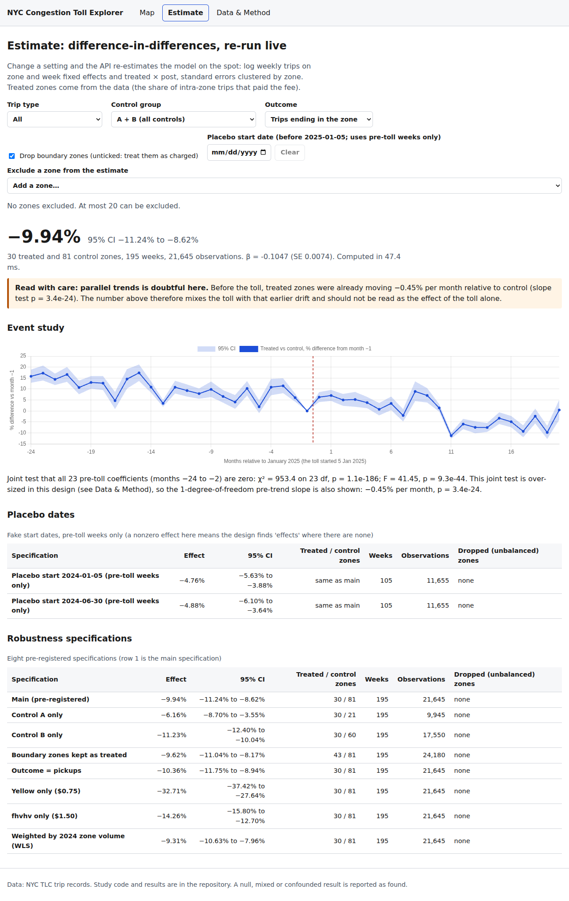
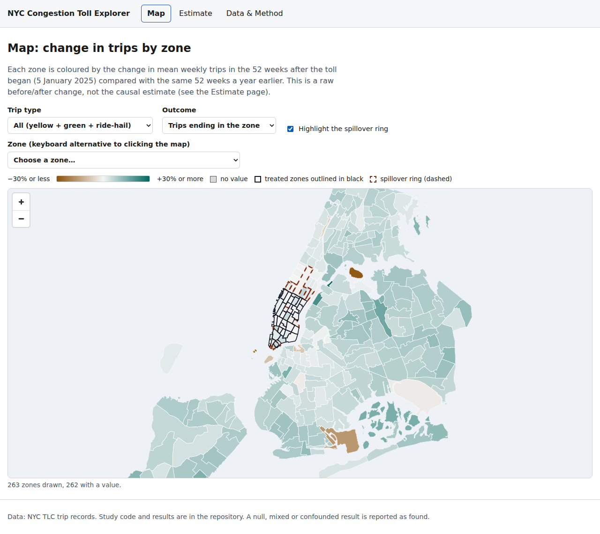
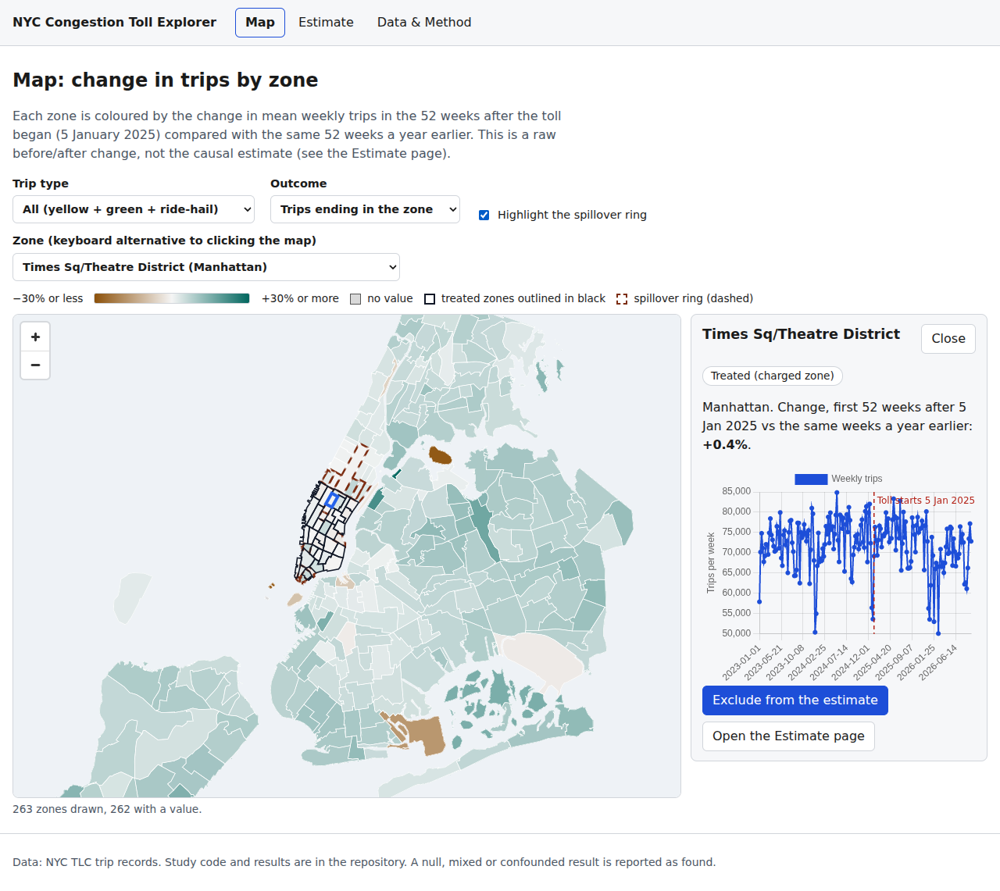
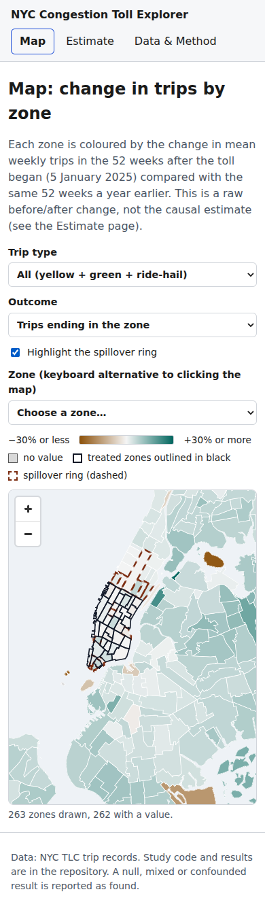

# NYC Congestion Toll Explorer

What did New York's Manhattan congestion toll, which started on **5 January 2025**, do to taxi and ride-hail trips into the zone? A reproducible causal study over the official TLC trip records (a DuckDB pipeline and statsmodels), published as an interactive map app whose GraphQL API **re-runs the difference-in-differences estimate live** in TypeScript.

> **Headline, honestly:** the pre-registered estimate is negative, but the study's own checks (pre-trend tests, placebo dates, a failed dose check, spillover) say the design does not isolate the toll's effect. The numbers table below is generated from `results/*.json`; the memo (`reports/memo.pdf`) explains what it does and does not show. A null, mixed or confounded result is reported as found.

Status: built and tested locally. **Not deployed**: the AWS CDK stack for Lambda, API Gateway, S3 and CloudFront is written, synthesised and tested, but nobody has deployed it (see `BLOCKERS.md` for the exact steps).



| Map | Zone panel | Phone |
|---|---|---|
|  |  |  |

Demo: `docs/demo.gif` (captioned real screenshots of the app).

## Numbers (generated by `make readme` from `results/*.json`)
<!-- numbers:start -->
| Area | Quantity | Value |
|---|---|---|
| Data | Raw trip records / files | 1,068,928,934 / 135 (2023-01 to 2026-09) |
| Data | Unexplained rows after reconciliation | 0 |
| Zones | Treated / boundary / control A / control B / ring | 30 / 13 / 21 / 60 / 14 |
| Planted effect | Mean bias with a planted −8% (seeds 0-19) | 0.07 pp |
| Planted effect | 95% CI coverage of the planted value | 19 / 20 |
| Planted effect | Lead test rejects with a planted pre-trend / with nothing planted (F form) | 20 / 18 of 20 |
| Main estimate | Effect on trips into the zone (pre-registered; NOT a clean causal estimate, see pre-trend) | −9.94% (95% CI −11.24% to −8.62%) |
| Pre-trend | Joint lead test (23 leads) | chi2 = 953.4, df 23, p = 1.1e-186 |
| Pre-trend | Treated-vs-control slope before the toll | −0.45% per month, p = 3.4e-24 |
| Placebos | Start 2024-01-05 / 2024-06-30 | −4.76% / −4.88% |
| Robustness | 8 specifications, min to max | −32.71% to −6.16% |
| Dose check | Yellow ($0.75) / high-volume FHV ($1.50) | −32.71% / −14.26% |
| Spillover | Ring vs control B / outer ring vs control B | −10.16% / −8.69% |
| Post hoc | With a treated-specific trend / 52-vs-52-week window | 2.48% / −4.21% |
| Estimator port | Max relative difference vs statsmodels over the reference cases | 9.59e-13 (61 cases) |
| API latency (local, not Lambda) | Cold-cache estimate p50 / p95 / max; warm p95 | 5.2 / 10.4 / 105.5 ms; 3.5 ms |
| Tests | pytest / Vitest / Playwright passed | 31 / 71 / 22 |
<!-- numbers:end -->

## Architecture
```
 TLC trip files (Parquet, official host)        TLC taxi zone shapefile
        | download 2 at a time, sha256                  |
        v                                               v
 study/ (Python 3.12, uv, DuckDB)          DuckDB spatial: WGS84 GeoJSON, adjacency (spillover ring)
   aggregate_month.sql per file -> daily counts (raw file deleted after aggregation)
        v
 data/agg/*.parquet + data/manifest.csv + results/reconciliation.json (raw = kept + excluded by reason)
        v
 panel.sql (weekly zone panel, window functions) -> statsmodels: DiD, event study, placebos, 8 specs,
 spillover, planted-effect simulation -> results/*.json, figures, memo
        |-- export: api/data/panel.bin + meta + zones.geojson (bundled into the Lambda)
        '-- export: results/estimator_reference.json (61 cases for the TypeScript equivalence test)

 api/  Node.js 24, TypeScript, Apollo Server: schema -> resolvers -> DataLoader -> in-memory panel;
       TypeScript TWFE estimator + cluster-robust SE, 500-entry LRU; depth and complexity limits;
       Lambda handler (HTTP API v2) and a local server on 127.0.0.1:4000
 web/  Vue 3, Vite, Pinia, MapLibre GL, urql: Map | Estimate | Data & Method
 infra/ AWS CDK v2: CloudFront -> S3 (OAC) and /graphql -> API Gateway HTTP API (throttled) -> Lambda (arm64)
```

## How to run
```
make setup        # uv sync, npm ci, Playwright chromium
make data         # download + aggregate + reconcile (restartable; about 25 GB passes through, 15 MB kept)
make study        # zones, panel, planted-effect simulation, all estimates
make export       # panel.bin, zones.geojson, the 61-case reference for the TS estimator
make dev          # API on 127.0.0.1:4000 and the web app on 127.0.0.1:5173
make test         # pytest, Vitest (api, web, infra), Playwright
make bench        # API latency (local), make memo, make readme, make bullets
make synth        # cdk synth (never deploys); make deploy is for the owner (BLOCKERS.md)
```
The committed aggregates (`data/agg/`) let everything after `make data` rerun in minutes.

## How it is tested
- **Study** (pytest): exclusion rules and reconciliation on fixture files; zone classification; the weekly panel on a hand-built 3-zone fixture (Sunday weeks, `LAG(52)` across a year gap); DiD on a hand-computed panel and against the demeaning algorithm; planted-effect simulation (5 seeds in CI, 20 in `make study`); the memo's numbers.
- **API** (Vitest + fast-check): the TypeScript estimator matches statsmodels on 61 cases; property tests (constants added to a zone or week, row order, a noise-free planted effect, excluding a zone); the binary loader; DataLoader batching; depth and complexity rejection; input validation; the Lambda handler.
- **Web** (Vitest, Playwright, axe): components, stores, the colour scale; end-to-end flows against the local API; axe WCAG 2.1 A/AA on every page at desktop and 390 px width.
- **Infra** (Vitest + cdk-nag): runtime, architecture, throttling, public access block, OAC, the `/graphql` behavior, zero unacknowledged AwsSolutions findings.
- **CI** (`.github/workflows/ci.yml`): study, node, contract (`make contract` shows no diff), e2e. The full download and the benchmark stay local with results committed.

## Study design in brief
Treated zones come from the data (the share of intra-zone trips that paid the fee); the main specification was fixed before any estimate; a planted-effect simulation had to pass before real data was touched; every deviation and decision is in `DECISIONS.md`.

## Limits
- Parallel trends fails in this design (see the numbers table); other 2025 changes, weather and trips that avoid the zone cannot be separated from the toll.
- The joint pre-trend test is over-sized here (only the treated clusters carry its information); a slope test is reported next to it.
- The planted-effect simulation assumes parallel trends and independent zone errors.
- API latency is measured locally, not on Lambda.
- Out of scope: synthetic control, wild cluster bootstrap, PPML, private-vehicle, subway or speed data, weather.
