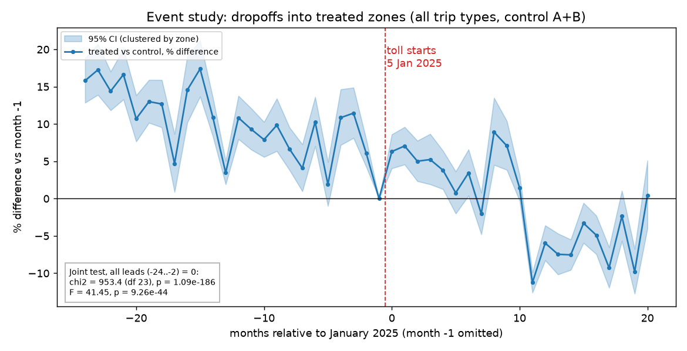

# Did New York's congestion toll reduce taxi and ride-hail trips into the zone?

*Two-page memo. Every number is filled in by code from `results/*.json`; a test checks them. Results generated at commit 966ffc8.*

## Bottom line
- The pre-registered main estimate is **−9.9%** (95% CI −11.2% to −8.6%) for weekly trips ending in the 30 charged zones relative to uncharged zones, but **it should not be read as the effect of the toll**: treated zones were already drifting down relative to control before the toll began (−0.45% per month, p = 3.4e-24), both placebo start dates give nonzero "effects" (−4.8% and −4.9%), and the lower-fee taxis fell more than the higher-fee ride-hail trips (dose check fails).
- Eight pre-registered specifications range from −32.7% to −6.2%. Two post-hoc analyses that deal with the pre-trend differently give 2.5% and −4.2%. **The data do not support a clean causal estimate of the toll's effect on these trips.**
- The estimator itself is sound: on simulated panels with a planted −8% effect it recovered −7.93% on average (bias 0.07 percentage points, CI coverage 19/20).

## Question and data
What did the Manhattan congestion toll (from Sunday 5 January 2025: $0.75 per taxi trip, $1.50 per high-volume ride-hail trip) do to trips into the charged zone? Data: 1,068,928,934 trip records in 135 official TLC files (yellow, green, high-volume FHV; 2023-01 to 2026-09). A per-file reconciliation shows raw rows = kept + excluded by reason with **0 unexplained rows**. DuckDB SQL reduces them to a weekly zone panel (weeks start on Sunday so that the toll starts on a week boundary).

## Design (fixed before any estimate was run)
Treated zones come from the data: a zone is treated if at least 95% of its intra-zone trips in February to December 2025 carried the congestion fee (the fee share jumps from 0.00% on 4 January to 95.1% on 5 January in those zones). That gives 30 treated zones, 13 boundary zones (left out of the main estimate), 21 uncharged Manhattan zones (control A) and the 60 busiest non-Manhattan zones (control B). The main specification is log weekly trips on zone and week fixed effects plus treated × post, standard errors clustered by zone (the 30 + 21 + 60 zones are the clusters), trip type all, outcome trips ending in the zone, all weeks to 2026-09-20. Before looking at real estimates, a planted-effect simulation (20 seeds) had to pass: it did (above). Its two caveats: it assumes parallel trends and independent zone errors, and the joint lead test it tests is over-sized (below).

## Results
**Main:** −9.94% (95% CI −11.24% to −8.62%). **Pre-trend:** the event study (figure) shows treated zones starting far above control and sliding down for two years before the toll. The joint test of all 23 leads rejects (χ² = 953.4 on 23 df, p = 1.1e-186; F = 41.5, p = 9.3e-44), but in simulation this joint test rejected 18 of 20 seeds with *nothing* planted (about 60% of 200 more seeds): it is over-sized because only the treated clusters carry its information, so the one-degree-of-freedom slope test is the better evidence (rejects 2 of 20 under the null, 7% over 200 seeds; observed slope −0.45% per month, p = 3.4e-24).

{: width="62%"}

**Placebos** (pre-toll weeks only): start 5 January 2024 −4.76% (CI −5.63% to −3.88%); start 30 June 2024, the original launch date before the June 2024 pause, −4.88% (CI −6.10% to −3.64%). **Robustness:** control A only −6.2%; control B only −11.2%; boundary zones kept as treated −9.6%; pickups −10.4%; weighted by 2024 volume −9.3%. **Dose check:** yellow taxis ($0.75) −32.7% vs high-volume ride-hail ($1.50) −14.3%: the larger effect is for the *lower* fee, which a toll-driven story would not predict. **Spillover:** the ring of zones touching the charged area is entirely partly-charged boundary zones, so it mixes partial treatment with spillover (−10.2%, CI −13.0% to −7.2%); the 8 uncharged zones next to the ring, against control B, show −8.7% (CI −10.2% to −7.1%), so control A is either contaminated or shares the trend; dropping them leaves the main estimate at −10.7%. **Post hoc** (added after seeing the pre-trend; not pre-registered): allowing a treated-specific linear trend gives 2.5% (CI 1.3% to 3.6%); comparing only the 52 weeks before and after gives −4.2% (CI −5.1% to −3.4%).

## What it means, and what it cannot show
The answer depends on how the pre-existing divergence is treated, from a decline of about −4.2% (short window) through −9.9% (main) to a small rise once a trend is allowed. This design cannot separate the toll from other 2025 changes that move the same zones (return-to-office policies, app pricing, the yellow-to-ride-hail shift, the federal attempt to end the program of 19 February 2025 and the court rulings that followed in May 2025 and on 3 March 2026), from weather, or from trips that now avoid the zone rather than vanish. It counts trips, not travellers. Zones are weighted equally in the main estimate. Treated zones near the 95% cut-off (for example Seaport and Hudson Square) are left out as boundary.

## Limits of the method and next steps
Parallel trends is the identifying assumption and the data reject it here; the planted-effect test proves the estimator works when the assumption holds, not that it holds. Out of scope and worth doing next: synthetic control, a wild cluster bootstrap (better calibrated with 30 treated clusters), Poisson (PPML) estimation, and private-vehicle, subway and speed data. A live version of the estimate (any trip type, control group, excluded zones or placebo date) runs in the app; the TypeScript estimator matches statsmodels to 9.6e-13 relative on 61 cases.

*Sources: NYC TLC trip record data (nyc.gov/site/tlc); MTA Congestion Relief Zone toll page; TLC industry notice 24-10; Courthouse News and amNY on the federal case; Planetizen on the 30 June 2024 start. Details in PROBE.md and the Data & Method page.*
